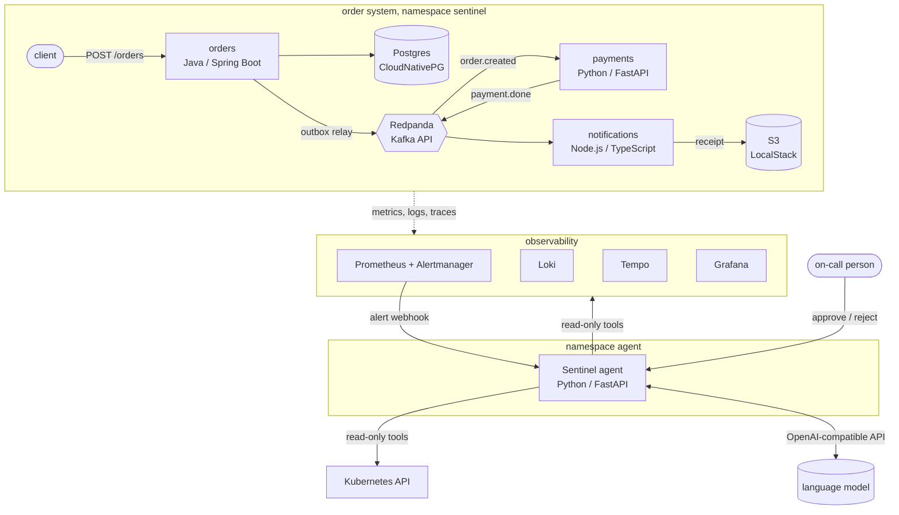

# Sentinel

An on-call agent for Kubernetes. When an alert fires, Sentinel collects the evidence an engineer would
look at first (unhealthy pods, events, crash logs, error logs, what changed in the latest rollout), asks
a language model to explain it, and suggests one fix. **A person approves the fix before anything
changes**, and the change runs with a separate, narrowly scoped token that expires after 10 minutes.
When the incident is over, Sentinel writes the post-mortem.

It runs against a small event-driven order system built for the purpose, deployed with Terraform and
Helm and observed with metrics, SLO alerts, logs and traces, and it was evaluated on 18 live incidents.

| | |
|---|---|
| **Bad deploy, live** | alert → incident in ~10 s → diagnosis ("`MAX_AMOUNT_CENTS` set to `'abc'` in the latest rollout") in ~30 s → one click → rollback done in 5 s → post-mortem |
| **Evaluation** | right cause in 15/18 live incidents (11/18 checked by hand); 3/3 on five scenarios, 0/3 on poison messages. [Details](eval/README.md) |
| **Safety** | read-only investigation; writes only after approval, only `get`/`patch` on three named deployments, with a 10-minute token |

## How it works



1. **Alert → incident.** Alertmanager sends every alert about the `sentinel` namespace to the agent.
   One incident per alert group; related alerts about the same workload within 30 minutes are grouped.
2. **Initial findings.** Fixed rules collect the obvious evidence before the model's first turn. Small
   models are much better at reading evidence than at deciding where to look; this one change took the
   bad-deploy diagnosis from 204 s and wrong to 31 s and right.
3. **Diagnosis.** The model reads the findings, may call read-only tools (Prometheus, Loki, Kubernetes),
   and answers with a JSON report: summary, cause, evidence, one suggested action, confidence.
4. **Fixed-rule check.** The same findings go through a few deterministic rules. The page warns when a
   strong rule disagrees with the model. The rules are also the evaluation baseline.
5. **Approval.** The agent's web page shows the report with **Approve and run** / **Reject**. Actions:
   restart, scale (refused when an HPA owns the deployment), or roll back to the previous revision.
6. **Post-mortem.** When the incident resolves: timeline, durations and actions from the record, plus an
   optional narrative from the model.

## Security model

| Identity | Can | Cannot |
|---|---|---|
| App pods | nothing on the Kubernetes API (no token mounted) | everything |
| `agent` | read pods, logs, events, deployments, replica sets, jobs, HPAs, the Postgres cluster in `sentinel`; request a token for `agent-actions` | read secrets, write anything, other namespaces |
| `agent-actions` | `get`/`patch` on `deployments` and `deployments/scale` for `orders`, `payments`, `notifications` only | delete, StatefulSets, LocalStack, secrets, other namespaces |

`agent-actions` has no stored token. One is requested with the TokenRequest API after each approval and
expires after 10 minutes. Every allow and deny was checked with `kubectl auth can-i`.

## Stack

| Area | Choice |
|---|---|
| Services | orders: Java 21, Spring Boot 4, transactional outbox · payments: Python 3.14, FastAPI, aiokafka · notifications: Node.js 26, TypeScript |
| Messaging and data | Redpanda (Kafka API), Postgres 18 via CloudNativePG, S3 via LocalStack |
| Platform | Kubernetes (k3d / k3s), Helm (one shared chart for all apps), Terraform (cluster and platform stacks) |
| Observability | Prometheus, Alertmanager, Grafana (dashboard as code), Loki + Alloy, Tempo + OpenTelemetry |
| Alerting | 2 SLOs (availability 99.9 %, latency 99 % < 500 ms) with multi-window burn-rate alerts, pipeline alerts, 16 promtool tests |
| Agent | Python 3.14, FastAPI, SQLite, server-rendered page (no JavaScript); any model behind an OpenAI-compatible API, by default `qwen3:4b` on a local Ollama |
| Tests | orders 17, payments 45, notifications 45, agent 132, evaluation tooling 7 |

## Quick start

Requirements: Docker Desktop (7 GB of memory), k3d, kubectl, helm, terraform, a free LocalStack token
(`LOCALSTACK_AUTH_TOKEN` in `.env`, see `.env.example`), and for diagnoses a model server, for example
[Ollama](https://ollama.com) with `ollama pull qwen3:4b` and `OLLAMA_CONTEXT_LENGTH=16384`.

```bash
./scripts/up.sh          # images -> k3d cluster -> platform -> services and agent (~3 min)
./scripts/smoke-test.sh  # places an order and waits for its receipt in S3
./scripts/down.sh        # removes everything
```

| What | Where |
|---|---|
| Agent (incidents, reports, approvals) | http://localhost:18003 |
| Grafana (dashboard "Sentinel / Overview") | http://localhost:3000, user `admin` |
| Prometheus | http://localhost:9090 |

Grafana's password is generated per cluster:
`kubectl -n monitoring get secret monitoring-grafana -o jsonpath='{.data.admin-password}' | base64 -d`

The model is set in [`infra/helm-values/agent.yaml`](infra/helm-values/agent.yaml) (`LLM_BASE_URL`,
`LLM_MODEL`, optional `LLM_API_KEY`). With `LLM_MODEL` empty, incidents are still recorded but not
investigated.

## Break it on purpose

Six chaos scenarios with inject/recover scripts and observed results: [`scripts/chaos/`](scripts/chaos/README.md).

```bash
kubectl apply -f infra/chaos/loadgen.yaml           # 2 orders/s
./scripts/chaos/payments-bad-config.sh inject       # then watch http://localhost:18003
./scripts/chaos/payments-bad-config.sh recover
```

Two of the six scenarios found real design flaws in the services (a dependency outage turned into a
restart loop that also hid the errors), fixed with in-process retries and reconnects.

## Evaluation

18 live runs, a fixed-rule baseline and a model comparison on recorded evidence:
[`eval/README.md`](eval/README.md). In short: the agent is specific where the rules are generic, and it
has one measurable bias (it blames a recent change on the alerted deployment, even a healthy one), which
is exactly what the approval step and the rule check are there to catch.

## Local development

```bash
cp .env.example .env    # then set a real POSTGRES_PASSWORD
docker compose up -d    # Postgres, Redpanda, Redpanda Console, LocalStack
docker compose --profile apps up -d --build   # also builds and starts the three services
```

| Service | Address |
|---|---|
| Postgres | `localhost:15432` |
| Redpanda (Kafka) | `localhost:19092` |
| Redpanda Console | http://localhost:8090 |
| LocalStack (AWS) | http://localhost:4566 |
| orders API | http://localhost:8080 (`POST /orders`) |

```bash
curl -X POST localhost:8080/orders -H 'Content-Type: application/json' \
  -d '{"customer_id":"cust-1","amount_cents":1999,"currency":"USD"}'
```

Stop with `docker compose down` (keeps data) or `docker compose down -v` (deletes data).

## Repository

```
services/orders | payments | notifications   the order system
services/agent                                the on-call agent
contracts/                                    event schemas
infra/terraform/cluster | platform            k3d cluster, then everything on it
infra/charts/                                 sentinel-service (all apps), sentinel-infra, agent-access
infra/helm-values/                            per-release settings
scripts/up.sh | down.sh | smoke-test.sh       lifecycle
scripts/chaos/                                six failure scenarios
scripts/eval/ and eval/                       evaluation harness, replay, results
```
